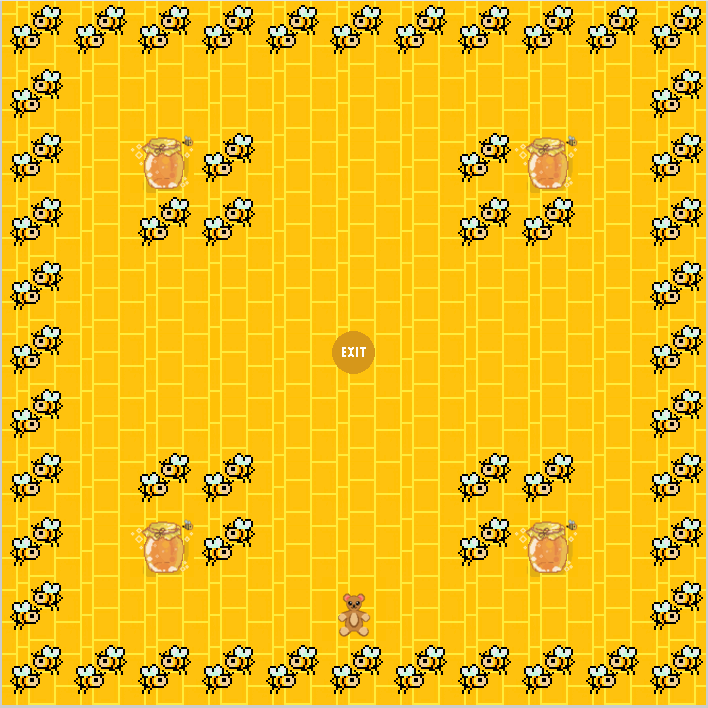

# so_long – ein kleines 2D-Spiel in C

Ein 2D-Spiel aus der Vogelperspektive, geschrieben in C mit der Grafikbibliothek [MiniLibX](https://github.com/42Paris/minilibx-linux). Entstanden im Rahmen des Curriculums an der **42 Vienna**.

> **Hinweis:** Entstanden 2023 an der 42 Vienna, 2026 überarbeitet und hier neu veröffentlicht – daher beginnt die Git-Historie erst 2026.

Der Spieler steuert einen Teddybären durch ein Feld voller Bienen, sammelt alle Honiggläser ein und erreicht anschließend mit möglichst wenigen Zügen den Ausgang.

Alle Grafiken im Spiel habe ich selbst gezeichnet, mit einem Pixel-Art-Editor im Browser, und anschließend ins XPM-Format umgewandelt.

<p align="center">
  
</p>

## Features

- Karten werden aus `.ber`-Dateien geladen. Jede rechteckige Karte funktioniert, solange sie auf den Bildschirm passt.
- Die Karte wird beim Laden geprüft, bei Fehlern erscheint eine entsprechende Meldung:
  - die Karte ist rechteckig und mindestens 3×3 groß
  - sie enthält nur erlaubte Zeichen (`0 1 P E C`)
  - es gibt genau einen Spieler, genau einen Ausgang und mindestens ein Sammelobjekt
  - die Karte ist vollständig von Wänden umschlossen
  - ein Flood-Fill prüft, dass alle Sammelobjekte und der Ausgang erreichbar sind
- Pro Zug werden nur die zwei geänderten Felder neu gezeichnet. Ein Expose-Hook zeichnet die ganze Karte neu, wenn das Fenster wieder sichtbar wird.
- Die Anzahl der Züge wird in der Konsole ausgegeben.
- Beim Beenden (Fehler, `ESC` oder Fenster schließen) werden alle Bilder, das Fenster und das Display freigegeben, sodass keine Speicherlecks entstehen.

## Steuerung

| Taste | Aktion |
| --- | --- |
| `W` / `↑` | Nach oben |
| `A` / `←` | Nach links |
| `S` / `↓` | Nach unten |
| `D` / `→` | Nach rechts |
| `ESC` oder Fenster schließen | Beenden |

Der Ausgang öffnet sich erst, wenn alle Honiggläser eingesammelt sind.

## Kompilieren & Starten

Linux mit X11, `cc` und `make` wird benötigt.

```bash
# Abhängigkeiten unter Debian / Ubuntu
sudo apt-get install gcc make xorg libxext-dev libbsd-dev zlib1g-dev

git clone https://github.com/ezararsi/so_long.git
cd so_long
make
./so_long maps/map1.ber
```

`make clean`, `make fclean` und `make re` funktionieren wie gewohnt.

## Kartenformat

Eine Karte ist eine Textdatei mit der Endung `.ber`:

| Zeichen | Bedeutung |
| --- | --- |
| `1` | Wand |
| `0` | Boden |
| `P` | Startposition des Spielers |
| `C` | Sammelobjekt (Honigglas) |
| `E` | Ausgang |

```
11111111111
10000000001
10C10001C01
10110001101
10000000001
10000E00001
10000000001
10110001101
10C10001C01
10000P00001
11111111111
```

Im Ordner `maps/` liegen gültige Beispielkarten und zwei absichtlich ungültige Karten (`failedtest1.ber`, `map3.ber`), mit denen sich die Kartenprüfung testen lässt.

## Projektstruktur

```
.
├── includes/so_long.h   # Spiel-Struct, Konstanten, Prototypen
├── sources/
│   ├── main.c           # Karte einlesen, Fenster erstellen, Event-Hooks
│   ├── map_check.c      # Kartenprüfung + Flood-Fill
│   ├── render.c         # Bilder laden und Felder zeichnen
│   ├── move.c           # Eingabe und Spiellogik
│   └── exit.c           # Argumentprüfung, Fehlerbehandlung, Aufräumen
├── img/                 # selbst gezeichnete XPM-Sprites (64×64)
├── maps/                # Beispielkarten
├── libft/               # eigene Nachimplementierung der C-Standardbibliothek
└── minilibx-linux/      # Grafikbibliothek MiniLibX
```

## Implementierungsdetails

- Die Karte wird als ein einziger String gespeichert, die Zeilen sind durch `\n` getrennt. Jede Position ist ein einzelner Index. Ein Schritt nach oben oder unten ist `± line_length`, nach links oder rechts `± 1`. Dadurch bleiben Bewegung und Flood-Fill kompakt.
- Die Position eines Zeichens im String `"10PEC"` ist direkt sein Index im Bild-Array. Zum Zeichnen ist deshalb keine `if`- oder `switch`-Kette nötig.
- Der Code folgt der Norm der 42: Funktionen haben höchstens 25 Zeilen, es gibt keine `for`-Schleifen und nur wenige Variablen pro Funktion.
